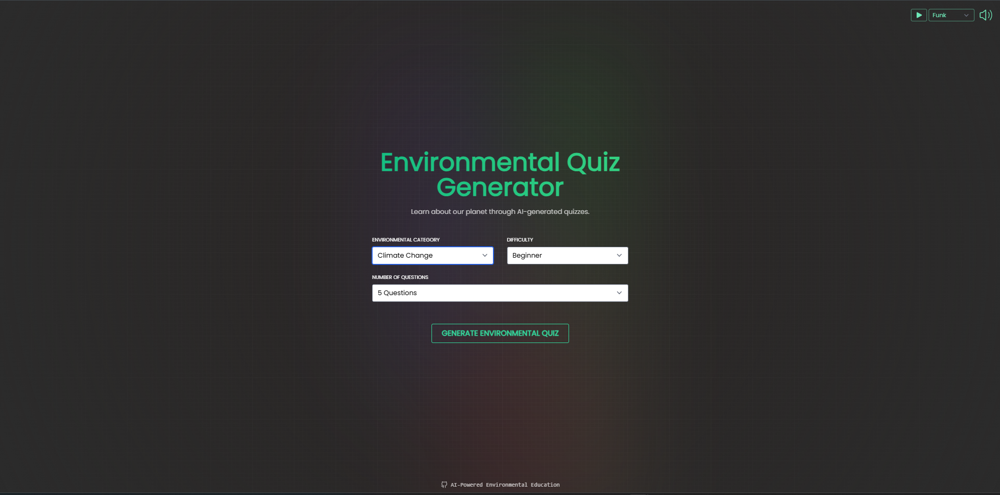
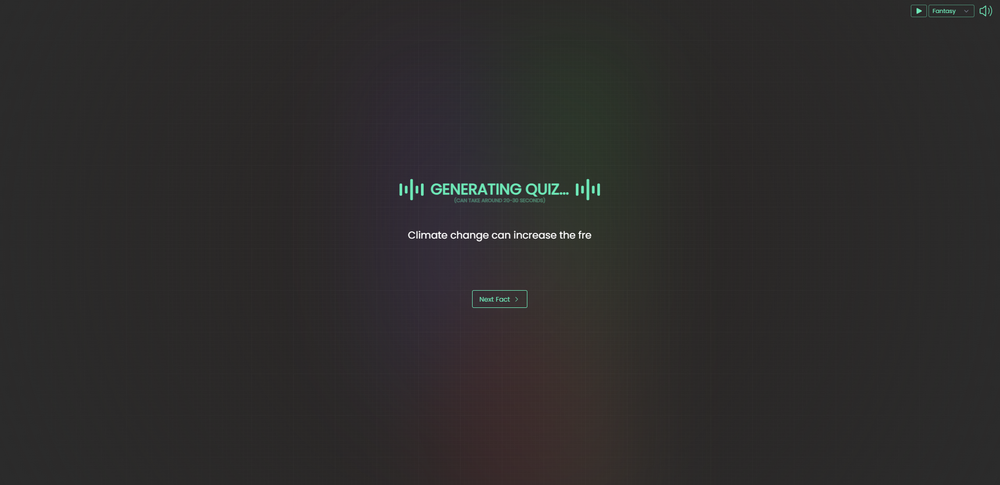
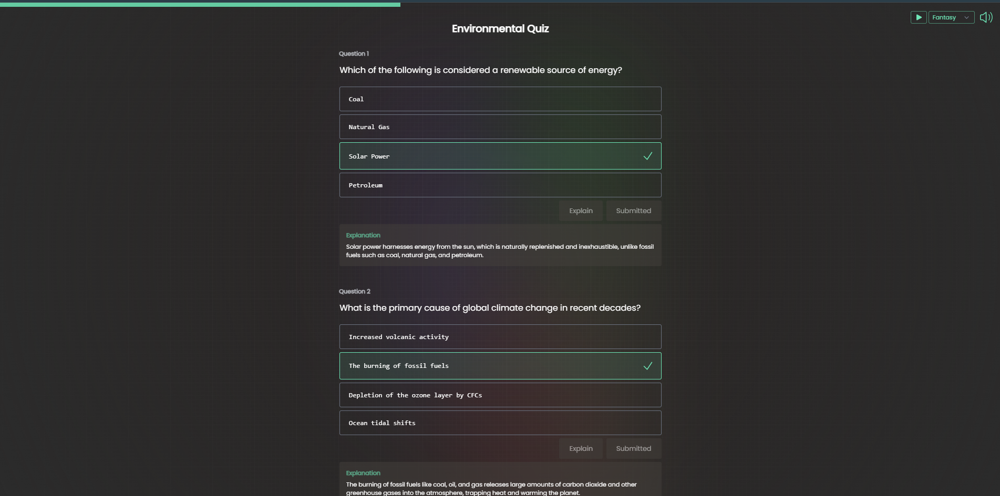
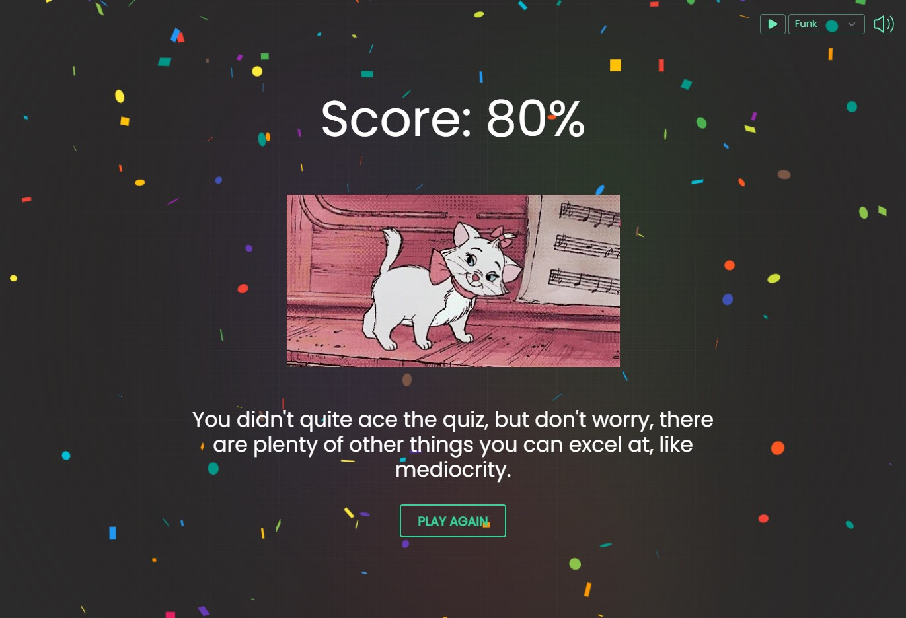

# 🌍 Environmental Quiz Generator

An AI-powered environmental science quiz generator built with **Next.js, React, Tailwind CSS, and Google Gemini API**. Users can generate multiple-choice quizzes on environmental topics with customizable difficulty levels and question counts.

## ✨ Features

- 🌱 **Topic Selection:** Generate quizzes on climate change, pollution, biodiversity, renewable energy, waste management, water conservation, and more.
- 🎯 **Customizable Difficulty:** Choose beginner, intermediate, or advanced questions.
- 📝 **Flexible Question Count:** Generate 5, 10, 15, or 20 questions.
- 🤖 **AI-Powered Quiz Generation:** Uses the Google Gemini API to generate environmental science questions, options, answers, and explanations.
- 🌿 **Environmental Facts:** Learn interesting environmental facts while the quiz loads.
- 📊 **Progress Tracking:** Track your progress as you answer questions.
- 🏆 **Results Dashboard:** View your final score, correct answers, and incorrect answers.
- 🎉 **Celebration Screen:** Enjoy score-based GIFs, motivational messages, and confetti for high scores.
- 🎵 **Audio Player:** Listen to the included background music while using the application.

## 🛠️ Tech Stack

- **Frontend:** React.js, Next.js, Tailwind CSS
- **AI Integration:** Google Gemini API
- **Language:** JavaScript
- **Styling:** Tailwind CSS
- **Version Control:** Git and GitHub

## 📦 Libraries Used

- [Next.js](https://nextjs.org/) — React framework
- [Tailwind CSS](https://tailwindcss.com/) — Utility-first CSS framework
- [react-confetti](https://www.npmjs.com/package/react-confetti) — Confetti animation
- [react-loader-spinner](https://www.npmjs.com/package/react-loader-spinner) — Loading animation
- [react-icons](https://react-icons.github.io/react-icons/) — Icons
- [react-use](https://github.com/streamich/react-use) — React utility hooks
- [react-simple-typewriter](https://www.npmjs.com/package/react-simple-typewriter) — Typewriter effect

## 🚀 Getting Started

### Prerequisites

- [Node.js](https://nodejs.org/) and npm
- A Google Gemini API key from [Google AI Studio](https://aistudio.google.com/apikey)

### Installation

1. Clone the repository:

   ```bash
   git clone https://github.com/NyashaChauhan/environmental-quiz-generator.git
   ```

2. Navigate to the project directory:

   ```bash
   cd environmental-quiz-generator
   ```

3. Install the dependencies:

   ```bash
   npm install
   ```

4. Create a `.env.local` file in the project's root directory and add your Gemini API key:

   ```env
   GEMINI_API_KEY=your_gemini_api_key_here
   ```

   Replace `your_gemini_api_key_here` with your own API key. **Never commit your real API key to GitHub.**

5. Start the development server:

   ```bash
   npm run dev
   ```

6. Open [http://localhost:3000](http://localhost:3000) in your browser.

## 🧠 How It Works

1. The user selects an environmental topic, difficulty level, and number of questions.
2. The application sends these settings to a Next.js API route.
3. The API route sends a prompt to Google Gemini.
4. Gemini generates multiple-choice questions with answer choices and explanations in JSON format.
5. The quiz displays the generated questions and tracks the user's answers.
6. The results page calculates the score and displays the correct and incorrect answer counts.

## 📸 Screenshots


### Home Page



### Loading Screen



### Quiz Screen



### Results Screen



## 🙌 Acknowledgements

This project is adapted from the original [AI Quiz Generator](https://github.com/quentin-mckay/AI-Quiz-Generator). The application has been modified to focus on environmental science and use Google Gemini for AI-powered quiz generation.

Please refer to the original repository's license for applicable reuse and attribution requirements.

## 🔐 Security

- Keep API keys in `.env.local`.
- Do not upload `.env.local` or other files containing secrets.
- Use environment variables for API credentials.

## 📄 License

Refer to the original project's license and applicable reuse terms before redistributing this adapted project.
